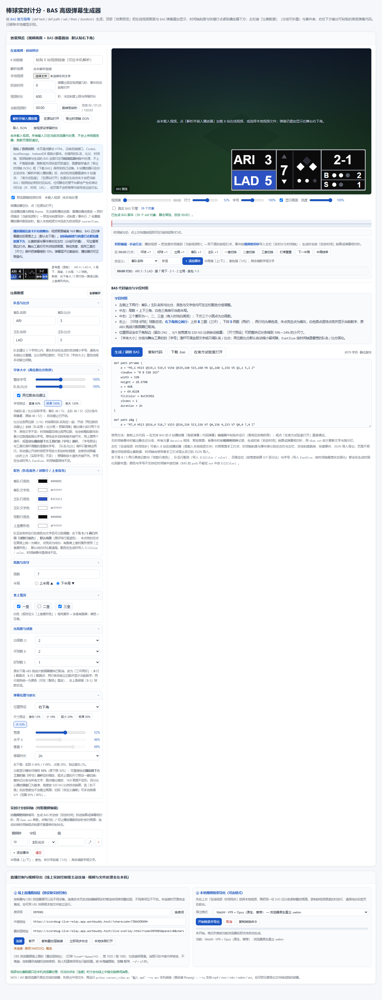

# 棒球实时计分 · BAS 高级弹幕生成器

一个**完全离线可用**的单文件工具，用来生成 B 站「高级弹幕」（BAS / Bilibili Advanced Script）脚本：把队伍名称、比分、局数、垒上情况、出局数、好坏球数做成一条贴在画面右下角的实时计分条；也可以对照视频画面按时间轴打点，自动生成带 `then set` 动画链的完整脚本。

脚本写法遵循 [BAS 官方指南](https://bilibili.github.io/bas/#/guide)：`def text` / `def path` / `set` / `then set` / `duration`。

**项目作者：狗王IB** ｜ [B 站主页](https://space.bilibili.com/150585) ｜ [GitHub 仓库](https://github.com/2BSB/baseball-scorebug-bas)
遇到使用问题，可在 [GitHub Issues](https://github.com/2BSB/baseball-scorebug-bas/issues) 留言，或通过 B 站后台私信作者。网页顶部与底部也内置了同样的作者信息与反馈入口。

## 更新说明

完整版本记录见 **[CHANGELOG.md](CHANGELOG.md)**。已发布的最新版本是 **v2.7 · 2026-11-10**：新增手机 / 平板专用的线上叠加层控制页 `mobile-control.html`、可选加入的在线房间列表、桌面端控制密钥显示与手机控制地址一键复制；线上服务已同步部署，GitHub 同步发布 [Release v2.7](https://github.com/2BSB/baseball-scorebug-bas/releases/tag/v2.7)，桌面增强包同步重打包。GitHub Pages 干净静态版依旧剔除全部云代码，也不含依赖服务端 API 的移动端页面。

上一批 **v2.6 · 2026-11-09**：网页新增作者信息与问题反馈入口、补齐历史更新记录，并把此前仅保存在本地的云服务、线上房间中继、直播叠加层、视频烧录导出、格式转换与验证脚本**全量同步到 GitHub**（[Release v2.6](https://github.com/2BSB/baseball-scorebug-bas/releases/tag/v2.6)）。

发布渠道：GitHub 仓库与 Release、[GitHub Pages 干净静态版](https://2bsb.github.io/baseball-scorebug-bas/)、[线上实时服务](https://scorebug-live-relay.app.workbuddy.host/?sharecode=73BAOORXNH)、桌面 `棒球计分弹幕生成器-本地增强包.zip`。

## 快速开始

1. 下载或 clone 本仓库，双击 **`棒球计分弹幕生成器.html`** 打开。直接用 `file://` 即可，不需要服务器，也不需要联网。
2. 左栏「比赛数据」是可折叠分组，改队名、比分、局数、垒包、出局数、球数、配色、字体大小、尺寸与位置。
3. 右栏「BAS 代码输出」实时生成脚本，复制后粘贴到 B 站高级弹幕编辑器即可投放。

## 界面与功能

- **效果预览**：顶部 16:9 舞台把视频画面与 BAS 记分弹幕叠加显示，默认贴右下角。弹幕层不拦截鼠标，播放器的播放、拖进度条仍可正常操作。
- **视频对照编辑**：粘贴 B 站链接嵌入在线播放器，或载入本地视频文件获得精确时间同步；时间轴刻度、邻近事件、快捷打点、事件表都紧贴播放器下方，不用上下翻页。
- **同步方式**：在线 iframe 跨域无法读取播放进度，看播放器时间填进「当前视频秒」即可同步预览；载入本地 `<video>` 后自动读写 `currentTime`。
- **投放时间**：按「投放时间」把视频绝对秒换算成弹幕相对秒，事件自动前移对齐。
- **打点**：坏球/好球/出局/得分/垒包/半局等快捷按钮，或自定义字段；支持时间轴 JSON 导入导出。
- **计分条**：B 行三坏、S 行两好；右下角 B / S 两行共用「球数行底色」，**默认纯黑 `#0B0B0C`**（可取色），未点亮空点统一暗灰、点亮后纯白；上垒菱形为纯白；队名底色与文字色可取色；尺寸可在 **10%–80%** 之间调整（含迷你/小/较小/标准/大预设），整块等比缩放且右下角贴边自动重算 X/Y。
- **字体大小**：左栏「字体大小」分组可调**整体字号**（60%–140%）与**队名/比分字号**（60%–140%），舞台工具栏也有一个就近的「字号」滑杆，两处双向同步，另有 80% / 100% / 120% 预设。默认开启**两位数自动避让**：比分到两位数时，按「队名宽 + 比分宽 + 预留间隙」等比缩小该行两个文字，避免 `RDA10` 这种挤在一起的情况；关闭开关即可完全手动控制。分组里会实时显示四个文字的实际字号。
- **渲染模式**：默认 SVG 预览；勾选「用真实 BAS 引擎渲染」会用内联的 BAS 引擎实际解析脚本，便于核对动画链。
- **URL 参数**：`?engine=1` 启用真实 BAS 引擎（本地自检用）；`?noplayer=1` 仅为兼容保留。页面默认就不加载任何在线播放器，也没有载入演示数据的后门，公网访问者打开即是空表单。

## 界面预览



更多截图：[打开页面首屏](界面截图/02-打开页面首屏.png) · [效果预览与记分条](界面截图/03-效果预览与记分条.png) · [记分条特写](界面截图/04-记分条特写.png) · [直播控制与视频导出](界面截图/06-直播控制与视频导出.png) · [BAS 代码输出](界面截图/09-BAS代码输出.png) · [线上叠加层](界面截图/10-线上叠加层-控制面板.png) · [作者信息与页脚](界面截图/12-作者信息与页脚.png)。
移动端控制页（v2.7）：[手机首屏](界面截图/13-手机控制页-首屏.png) · [手机全页](界面截图/14-手机控制页-全页.png) · [平板两列](界面截图/15-平板控制页.png)。

## 文件说明

| 文件 | 用途 |
| --- | --- |
| `棒球计分弹幕生成器.html` | **主交付物**：内联了 jQuery、BAS 引擎、生成器与时间轴适配层的单文件离线工具 |
| `CHANGELOG.md` | 按版本批次记录的更新说明 |
| `界面截图/` | 界面、记分条、叠加层与导出功能的截图 |
| `mobile-control.html` / `bundle_mobile.js` | 手机 / 平板控制页（单文件）及打包脚本，模板为 `_refs/mobile_control_source.html` |
| `video-burn.js` / `convert_video.py` | 视频烧录导出与 MOV / AVI 本机格式转换 |
| `serve_overlay.py` | 本机 127.0.0.1:8765 同源叠加层预览服务 |
| `_refs/*.js` | 打包、静态版构建、线上版同步与 CDP 端到端验证脚本 |
| `scorebug-generator.js` | 核心：BAS 生成、SVG 预览、位置计算、状态按时间推进 |
| `video-timeline.js` | B 站链接解析、播放器地址拼接、时间码换算、时间轴对齐 |
| `_refs/generator_source.html` | 未打包的 HTML 模板（修改界面请改这里） |
| `bundle.js` | 把依赖脚本内联进模板，产出单文件 HTML |
| `build.js` / `build-video-bas.js` | 生成 `.bas` / `.json` / `.csv` 交付文件 |
| `jquery.min.js` / `bas-engine.js` | 内联依赖，jQuery 与 BAS 官方引擎 |
| `reference-scoreboard.png` | 界面里显示的原版记分板参考图 |
| `public-site/index.html` + `public-site/reference-scoreboard.png` | **公网发布目录**：只有干净的静态网页与参考图，可直接上传到任意静态托管 |
| `docs/index.html` + `docs/reference-scoreboard.png` | 与 `public-site` 内容相同，供 GitHub Pages 使用（Pages 要求目录名为 `docs`） |
| `live-overlay.html` / `bundle_overlay.js` | 独立透明直播叠加层（单文件）及其打包脚本 |
| `relay-client.js` / `online-app/` | 线上房间中继客户端与零依赖单端口服务（静态页 + WebSocket + 长轮询） |
| `cloud-sdk.global.js` | WorkBuddy 云 SDK 的 IIFE 构建（内联，保持零外链脚本） |
| `cloud-config.js` | `workbuddy_cloud_service` 返回的 `publicConfig`（仅公开字段） |
| `cloud-sync.js` | 云端房间快照模块 `window.ScorebugCloud`（保存 / 恢复 / 状态与错误分类） |

> 示例视频 [BV19f4H6xE9B](https://www.bilibili.com/video/BV19f4H6xE9B/) 的画面中没有记分板、也没有字幕识别，早期附带的时间轴是**手工演示数据**，不是自动识别结果；本项目已移除模型识别接口。为让仓库保持干净，示例 `.bas` / `.json` / `.csv` 交付文件已从发布内容中移除，需要时可运行 `node build.js` / `node build-video-bas.js` 在本机重建；示例数据**不会打包进网页**。

## 公网发布与隐私

- **静态站点**：`public-site/`（同步 `docs/`）含 `index.html`、`live-overlay.html`、`reference-scoreboard.png`，已上线 <https://2bsb.github.io/baseball-scorebug-bas/>。v2.6 起仓库 `main` 已与本地全量同步，Pages 会自动按 `docs/` 重建；仓库里同时提供完整的线上服务源码，但 `docs/` 目录本身始终只是干净静态版（v2.7 的移动端页面依赖服务端 API，不在此目录）。
- **线上实时服务**：`online-app/` 是独立的单端口 Node 服务（零依赖），分享链接：`https://scorebug-live-relay.app.workbuddy.host/?sharecode=73BAOORXNH`；它同时提供控制器页面、叠加层页面、移动端控制页 `/m.html` 与房间中继，v2.7 已重新部署。
- **依赖**：线上应用版 HTML 含 10 段内联脚本（jQuery 3.2.1、BAS 引擎、`scorebug-generator.js`、`video-timeline.js`、`relay-client.js`、`video-burn.js`、`cloud-sdk.global.js`、`cloud-config.js`、`cloud-sync.js`、页面主逻辑），**0 个外链 `<script>` / `<link>`**；唯一外部资源是同目录 `reference-scoreboard.png`。GitHub Pages 干净版（`public-site/` / `docs/`）由构建脚本**剔除全部云服务代码块**，回到 7 段脚本、零云请求。
- **页面初始状态**：B 站链接、播放器、视频 URL 全部为空；视频时长默认 600 秒；不预置任何示例比赛数据。B 站 iframe 只在点击「解析并嵌入播放器」后由使用者浏览器直接请求。
- **默认完全离线**：没有 Cookie、`localStorage`、`sessionStorage`、IndexedDB、统计脚本；队名、比分、时间轴、视频与生成的 BAS 只在当前标签页内存里。**唯一例外**是 `relay-client.js`：只有点击「连接」后才会与线上中继建立 WebSocket（或 HTTP 长轮询兜底）；线上应用版另有 `cloud-sync.js`，只在主动保存 / 恢复 / 连接，或叠加层加载房间时访问云数据库。构建脚本会强制检查，页面主体不得出现任何网络调用。
- **中继不落盘**：房间与消息只在服务进程内存，空闲 30 分钟自动清理；不写文件、不写数据库、不记录消息内容。控制器带随机控制密钥，观众只读。任何托管平台都会有标准访问日志（IP / 时间 / URL），这是 HTTP 服务无法关闭的；但比赛数据不会写进 URL 或日志。
- **云端快照例外**：只有主动使用「保存到云端」才会把比赛状态持久化到应用专属云数据库（见下节）；不使用则云端不留任何比赛数据。Pages 静态版连这部分代码都不含，隐私承诺不变。
- **移动端房间列表（v2.7）**：`/api/rooms` 只列仍有人在线的房间号、控制 / 观看人数与「是否需要密钥」标记，不返回控制密钥、历史消息或比赛数据；`/api/state` 返回同房间最后一次 `state`（与叠加层本来就能收到的一致），供手机接管时不覆盖桌面端时间轴。移动端页面依赖服务端 API，只随线上服务提供，不进 Pages 静态版；在托管域名下访问这些接口同样要带上 `sharecode`，否则会被平台拦截（本机 `node online-app/server.js` 无此限制）。

## 云服务接入（WorkBuddy Cloud Service）

已为应用「棒球计分直播中控」开通云服务（`billingStatus=normal` / `provisionStatus=assigned`），接入 **Database** 模块，把原来只在内存里存活 30 分钟的房间状态升级为可跨设备恢复的云端快照。

- **数据表** `public.scorebug_rooms`：主键 `room_id`，含 `owner_id`、`control_key_hash`、`state` / `events` / `options`（JSONB）、`duration`、`revision`、`updated_at` / `created_at`。已启用 RLS，对 `anon` / `authenticated` 授予 SELECT / INSERT / UPDATE 策略（公开读、受控写），不提供 DELETE 策略。
- **模块** `cloud-sync.js`（`window.ScorebugCloud`）：`status()` / `saveRoom()` / `loadRoom()`，全部走 SDK 的 `cloud.database`。**唯一客户端初始化点**使用 `cloud-config.js` 中来自 `workbuddy_cloud_service(activate)` 返回 `publicConfig` 的 `endpoint` / `publishableKey` / `oauthRelayBaseUrl`，页面不含任何服务端密钥。
- **控制器**：底部「① 线上直播叠加层」新增「保存到云端 / 从云端恢复」。连接房间后或手动保存过之后，比赛状态变化会节流 2.5 秒写入云端；写入前校验控制密钥哈希，已被其它控制器占用的房间拒绝覆写。
- **叠加层**：加入房间时自动读取同房间云端快照，面板显示「第 N 版快照」，之后每 20 秒检查一次 `revision`，作为 WebSocket / 长轮询之外的兜底；控制器不在线也能恢复最后一版比分。
- **失败路径**：未配置 / SDK 缺失 / 网络异常 / 权限拒绝 / 配额不足 / 表缺失 / 密钥不匹配 / 房间号非法，都返回明确中文提示，本地生成与视频导出不受影响。
- **隐私边界**：云端快照是**用户主动保存**才产生的、按房间号隔离的协作数据，不是账号私有数据；云数据库会保留保存过的快照，视频文件与 BAS 仍只在本机处理。GitHub Pages 静态版不含任何云代码。
- **验证**：`_refs/verify_v25_cloud.js` 在正式域名（同源，满足云服务精确 Origin 校验）装载新构建页面，实测写入读回、跨页面恢复、另一房间不串台、错误密钥被拒、干净版无云代码；`_refs/verify_v25_online.js` 在**重新发布后的公网页面**直接复测保存、云端恢复与房间隔离。两者全部通过，线上 `/api/health` 返回 `cloud: workbuddy-cloud-service`。

## 直播叠加层（线上房间 · 跨设备实时控制）

**分享链接**：`https://scorebug-live-relay.app.workbuddy.host/?sharecode=73BAOORXNH`（打开即为控制器页面）。

1. 打开分享链接，页面底部「① 线上直播叠加层」会自动填好中继地址与一个随机 6 位**房间号**，点「连接」。
2. 点「复制叠加层链接」，把得到的地址粘到 OBS / 直播软件的「浏览器源」（宽 1920 / 高 1080、勾选透明背景）。控制器与 OBS 可以在不同设备、不同网络。
3. 之后在控制器改比分、打点、拖时间轴，同房间叠加层实时更新；点「立即同步状态」可强制推送一次。不同房间完全隔离，多人同时使用不会串台。
4. 离线时仍可用：「本地快照打开」用 URL hash 传数据；`live-overlay.html?room=XXX&offline=1` 或导入「导出时间轴 JSON」独立运行；`python serve_overlay.py` 依旧只监听 127.0.0.1:8765、不写访问日志，供本机同源 `BroadcastChannel` 同步。
5. 叠加层面板按 `H` 隐藏、`空格` 播放/暂停、`←/→` ±5 秒；`?clock=0` 关闭自动走时。创建房间时另生成 12 位**控制密钥**，别人只知道房间号只能观看，不能改你的比分。
6. **不要删掉链接里的 `sharecode`**：托管平台用它放行请求，页面会自动把它透传到叠加层地址、WebSocket 与轮询接口；删除后叠加层会返回 403。分享链接本身可复制给同伴，但拿到同一房间号的人只能观看。

**隔离机制**：连接时房间号由服务端绑定，客户端消息体里的 `room` 字段一律忽略；服务端只向同房间广播，客户端二次校验 `m.room` 并丢弃自己的回声；同源 `BroadcastChannel` 频道名也带房间号。模块 `relay-client.js`（`window.ScorebugRelay`）、`online-app/server.js`。

## 移动端控制页（手机 / 平板 · v2.7 已发布）

由 `online-app/server.js` 提供，访问 `/mobile-control.html` 或短地址 `/m.html`。线上可直接打开 `https://scorebug-live-relay.app.workbuddy.host/m.html?sharecode=73BAOORXNH`（手机与控制器需在同一房间）。桌面控制器点「复制手机控制地址」会生成带房间号与控制密钥的链接，**只发给自己的手机，不要公开分享**；从线上服务直接打开 `/m.html?sharecode=…` 也可以。

1. **可选加入的房间号**：「当前在线房间」列出仍有人在线的房间号、控制 / 观看人数与「是否需要密钥」标记，点一下直接加入；也可手填 4–12 位房间号，点「随机」新建，或留空自动生成。列表每 12 秒（页面可见时）刷新一次。
2. **控制权限**：填控制密钥＝可控制；留空＝只读观看，控制按钮自动禁用。桌面控制器的「① 线上直播叠加层」现在会显示并允许复制自己的控制密钥。换房间、断开都不影响其它房间。
3. **贴合手指**：39 个可点控件全部 ≥44px，主要按钮 54–60px；比分用大 `−/+`，局数、B / S 球数、出局用大圆点直接点选设定，垒包是大菱形按钮；「一键打点」含坏球 / 好球 / 出局 +1、清空球数 / 垒包、换半局重置；`±5 秒` 与「同步时间」控制叠加层走时。输入框统一 16px 防 iOS 自动缩放、禁用双击缩放、适配刘海屏安全区、可开轻微振动反馈；平板 ≥700px 自动两列。
4. **接管已有房间**：加入时通过 `/api/state` 读取房间最后一次状态（含时间轴与配色），不会把桌面端的时间轴覆盖成空白；加入后桌面与手机互相同步（最近一次本地操作 600ms 内不覆盖）。
5. **隐私边界**：`/api/rooms` 只返回仍有人在线的房间号、人数与是否需要密钥，不返回控制密钥、历史消息或比赛数据；`/api/state` 返回的内容与同房间叠加层本来就能收到的 `state` 一致。控制页零外链脚本、不写 Cookie / localStorage，房间与消息仍只在服务内存。该页依赖服务端 API，**不放进 GitHub Pages 干净静态版**。
6. **验证**：`_refs/verify_v27_mobile.js` 用手机视口 + 真实触摸事件跑通房间列表、chip 加入、控制密钥 / 只读、状态推送、房间隔离、`/api/state` 恢复与零未捕获异常；截图见 `界面截图/13~15`。

## 视频导出（可选格式）

- 先在「在线视频 · 时间同步」选择**本地视频文件**，再在「② 本地视频烧录导出」选择格式，点「开始烧录并导出」：Canvas 逐帧绘制画面并叠加同一份 SVG 记分条，`MediaRecorder` 直接输出浏览器原生支持的容器。
- 格式下拉由 `MediaRecorder.isTypeSupported` 实时生成：WebM（VP9 / VP8）、**MP4（H.264 + AAC）**、MKV（H.264）；MOV / AVI 先导出 MP4 中间文件，再用本机脚本转换。某个容器录制失败时自动回退到下一个候选，并在界面提示。
- 转换：`python convert_video.py "棒球计分-叠加视频.mp4" --to mov`，`--to` 支持 `mp4 / mov / mkv / webm / avi`；导出后页面会给出可直接复制的命令。未安装 ffmpeg 会打印安装提示与等价手工命令，不会联网下载。
- 录制是**实时的**（按视频原速播放一遍，需保持标签页在前台），可点「取消」；导出长度取「视频时长」与实际视频时长的较小值。需要 Chrome / Edge 桌面版。模块 `video-burn.js`（`window.ScorebugBurner`）。
- **字幕导出（SRT / WebVTT / ASS）已按要求删除**：按钮、模块 `subtitle-export.js`、ASS 烧录脚本与相关文档全部移除。

## 验证

- `_refs/verify_v24_main.js`：主页面无 JS 错误、字幕 UI 为 0、格式下拉、BAS 长度、外链脚本 0。
- `_refs/verify_v24_formats.js`：浏览器内合成短视频，逐格式真实导出并校验容器签名与扩展名。
- `_refs/verify_v24_relay.js`：多房间 / 多客户端并发，验证状态与秒数不串台、跨房间伪造被拒、控制密钥生效、HTTP 轮询兜底。
- `_refs/verify_v24_browser.js`：**两个独立浏览器实例**（控制器一台、OBS 一台）模拟「两个主播同时开播」，验证 A 的控制不会改到 B 的画面，并断言状态确实经线上中继到达（排除同源广播假阳性）。
- 对公网复测：`SITE='https://…/?sharecode=…' node _refs/verify_v24_relay.js`，`SITE='…' node _refs/verify_v24_browser.js`。本地与线上两套均通过。
- `_refs/verify_v25_cloud.js`：云服务端到端验证。在正式域名（同源）装载新构建页面，覆盖 SDK 状态、云端写入读回、另一房间无数据、错误控制密钥拒绝、非法房间号、主页面按钮真实保存、叠加层从云端恢复并渲染、干净静态版无云代码。全部通过。
- `_refs/verify_v25_online.js`：**重新发布后**直接访问公网页面复测：云模块就绪、零外链脚本、保存到云端、叠加层从云端恢复出保存的队名与比分、另一房间不串台。全部通过。
- `_refs/verify_v26_author.js`：逐一验证主工具、GitHub Pages 干净静态版、线上应用副本三份页面的作者栏、页脚反馈入口、B 站主页 / Issues 链接、零外链脚本、无 JS 异常、页脚位置与云代码一致性，并确认 OBS 叠加层不含作者信息；同时生成 `界面截图/12-作者信息与页脚.png`。全部通过。
- `_refs/verify_v27_mobile.js`（v2.7 新增）：启动本机中继服务，用 390×844 手机视口 + `Input.dispatchTouchEvent` 真实触摸，验证房间列表 chip 加入、控制密钥 / 只读模式、触摸改比分与队名后叠加层实时更新、换房间不串台、`/api/state` 恢复、全部按钮 ≥44px、零外链脚本与零未捕获异常。全部通过。`_refs/capture_mobile.js` 生成 `界面截图/13~15`。
- `_refs/verify_v27_online.js`（v2.7 新增）：**重新部署后的公网复测**，用 3 个独立 Chrome 实例（手机控制器 + 同房间 OBS + 另一房间 OBS）访问正式域名，验证页面与 `/m.html`、`/api/rooms`、`/api/state`、`/api/health` 可用且 `sharecode` 透传、不带 `sharecode` 返回 403、触摸改比分与队名后同房间叠加层实时更新、另一房间不串台、接口不泄露控制密钥、零外链脚本与零未捕获异常。共 27 项断言全部通过。

## 重新构建

需要 Node.js（仅用于构建，运行生成器不需要）：

```bash
node bundle.js                    # 用 _refs/generator_source.html + 9 个依赖（含云 SDK/配置/同步）打包单文件 HTML
node bundle_overlay.js            # 用 _refs/live_overlay_source.html 打包 live-overlay.html（同样含云模块）
node bundle_mobile.js             # 打包 mobile-control.html 并同步到 online-app/public/（手机控制页）
node _refs/build_public_site.js   # 同步 public-site/：剔除全部云代码块 + 隐私检查
node _refs/build_online_app.js    # 同步 online-app/public/ 的控制器、叠加层与参考图（移动端页面由 bundle_mobile.js 同步）
RELAY_ORIGIN='https://…/?sharecode=…' node _refs/bake_relay.js  # 写入默认线上中继地址
cp public-site/index.html docs/index.html && cp public-site/live-overlay.html docs/live-overlay.html
node build.js                     # 重建默认 BAS 与小型时间轴示例
node build-video-bas.js           # 重建完整 BAS、示例 JSON 与 CSV 对照表
node online-app/server.js         # 本地启动线上服务（PORT 环境变量，默认 3000）
```

## 实现要点与已知限制

- BAS 的 `path` 对象**不能在 `set` 时间轴里动态修改 `fillColor`**，因此配色在生成时固化；垒包/球数的状态切换用「暗底 path + 亮色覆盖 path + `alpha` 0/1」实现。
- 队伍名称过长会挤压比分，生成器对队名文本做了自动缩放；两位数比分（≥10）则由「自动避让」同时缩小队名与比分。
- 字号写在 `def text` 的 `fontSize` 里、时间轴只改 `content`，因此生成时会取**整段时间轴中队名最长 / 比分位数最多**的状态固化字号，保证后续比分变成两位数时依然不挤；这也意味着字号无法在时间轴中途切换。
- 在线播放器为跨域 iframe，无法读取播放进度，需要手动同步时间；分 P 跳转使用 B 站官方 `p` 参数（网页不预置任何视频的 `cid`）。
- 在 `file://` 下真实 BAS 引擎的 Blob Worker 会被拦截，工具内已关闭 Worker 并改用测试模式渲染。
- 界面里的「上垒白色」「球数行黑色底」「默认右下角」「三坏两好」「尺寸下限 10%」「字号 100% + 自动避让开启」均为当前默认设置，可在界面或代码里调整。

## 第三方依赖

`jquery.min.js` 与 `bas-engine.js` 来自 jQuery 与 B 站 BAS 开源项目，版权归各自原作者所有，仅用于本地离线预览与真实脚本解析；`reference-scoreboard.png` 为界面参考图。`cloud-sdk.global.js` 是 `@tencent-ai/workbuddy-cloud-sdk@dev` 的 IIFE 构建（从官方 CDN 下载后内联，避免运行时外链）。若用于公开分发，请自行确认并保留相应的许可声明。
